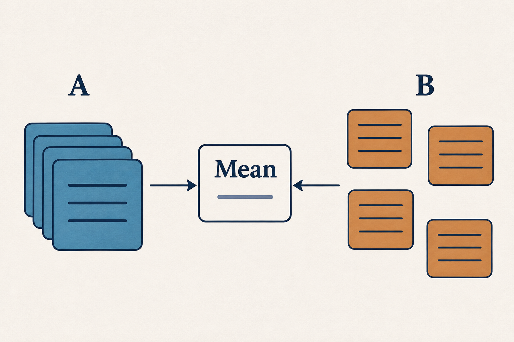
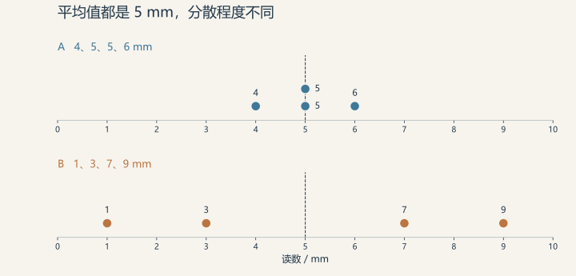

# 平均数相同，为什么数据差别还很大？

## 问题是什么

两台装置各读数四次，平均数都是 5 mm。只看汇总表，两台装置似乎给出了同样的信息；展开每次读数，却能看到一组紧挨着 5，另一组相隔很远。平均数把一组数压缩成一个位置，原来的波动没有一起保留下来。要解释这两组数据，除了问“中心在哪里”，还要问“每次读数离中心多远”。

## 原理怎么理解

平均数的计算是把所有数相加，再除以个数。不同的数组可以有相同的总和，所以平均数相同，并不要求每个数也接近。一个偏低读数和一个偏高读数，对平均数的影响可能相互抵消。[NIST 的位置指标说明](https://www.itl.nist.gov/div898/handbook/eda/section3/eda351.htm)给出了平均数的定义。

图 1｜概念示意：两组观测可得到相同的 Mean，但这个汇总值不能还原各次观测。精确位置与数值见图 2。

描述波动时，可以看极差和标准差。极差是最大值减最小值，容易读懂；标准差则把各个数偏离平均数的距离纳入计算，用与原数据相同的单位表达离散程度。标准差越大，说明按这个指标衡量的分散程度越高。[NIST 的离散程度说明](https://www.itl.nist.gov/div898/handbook/eda/section3/eda356.htm)同时解释了这两种指标。

## 用一个案例说明

下面是一个人为构造的举例，不来自实际装置测试。A 的四次读数为 4、5、5、6 mm；B 为 1、3、7、9 mm。两组相加都是 20 mm，除以 4，平均数都是 5 mm。

| 组别 | 四次读数 / mm | 平均数 / mm | 极差 / mm | 样本标准差 / mm |
|---|---|---|---|---|
| A | 4、5、5、6 | 5 | 2 | 0.82 |
| B | 1、3、7、9 | 5 | 8 | 3.65 |

A 的偏离是 −1、0、0、1，平方后合计为 2；B 的偏离是 −4、−2、2、4，平方后合计为 40。这里计算样本标准差，先把各自的平方和除以 3，也就是样本数减 1，再开平方，得到表中的 0.82 和 3.65。计算口径固定，比较才有明确含义。

图 2｜举例数据，每个圆点代表一次读数。两行使用相同横轴，虚线均在 5 mm；A 中两个 5 mm 的点上下错开，便于看清。

## 怎样应用

如果任务只需要汇报多次读数的平均位置，两台装置在这个例子中给出的平均值相同。如果任务要求每一次读数都落在 4–6 mm，A 的四次读数全部符合，B 没有一次符合。相同的汇总值，在不同的问题下有不同的用途。

整理类似数据时，先保留每次读数，再同时展示中心位置、离散程度和原始点。比较图应使用相同的坐标范围，否则较窄的横轴可能把小波动放大。对于这两组四次读数，能直接判断的是本次记录的分散情况；要判断装置长期是否稳定，还需要跨时间取得更多记录。

## 参考资料

- [NIST：Measures of Location](https://www.itl.nist.gov/div898/handbook/eda/section3/eda351.htm)
- [NIST：Measures of Scale](https://www.itl.nist.gov/div898/handbook/eda/section3/eda356.htm)
