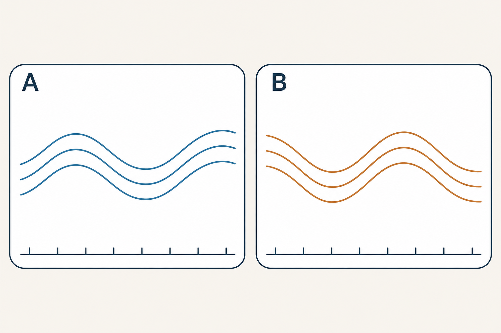
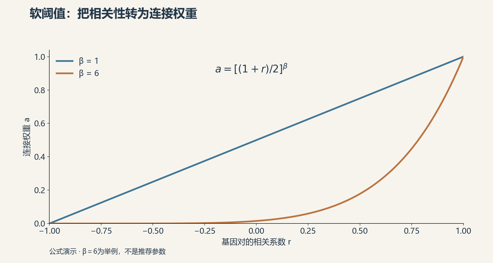
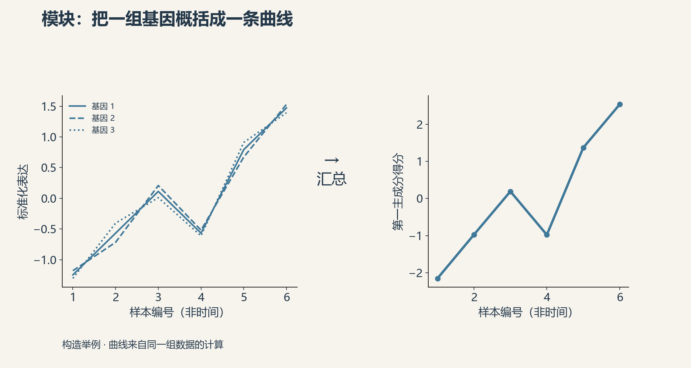
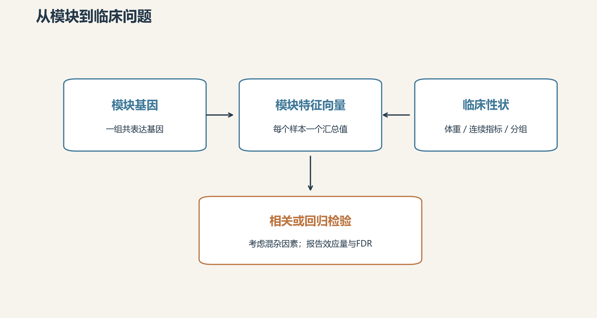
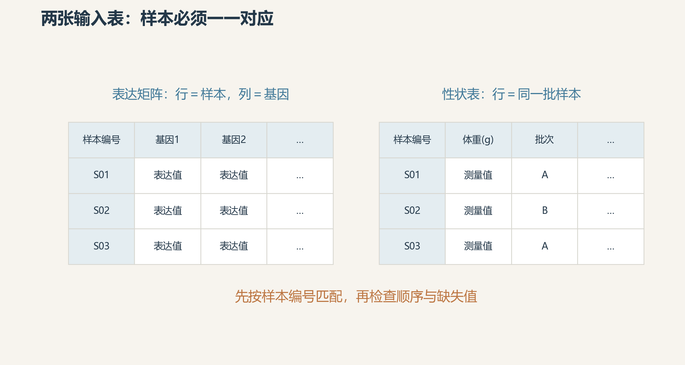
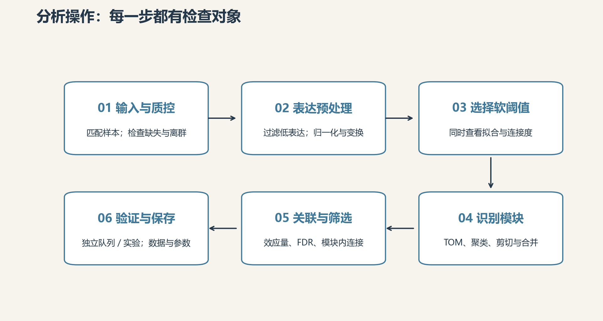
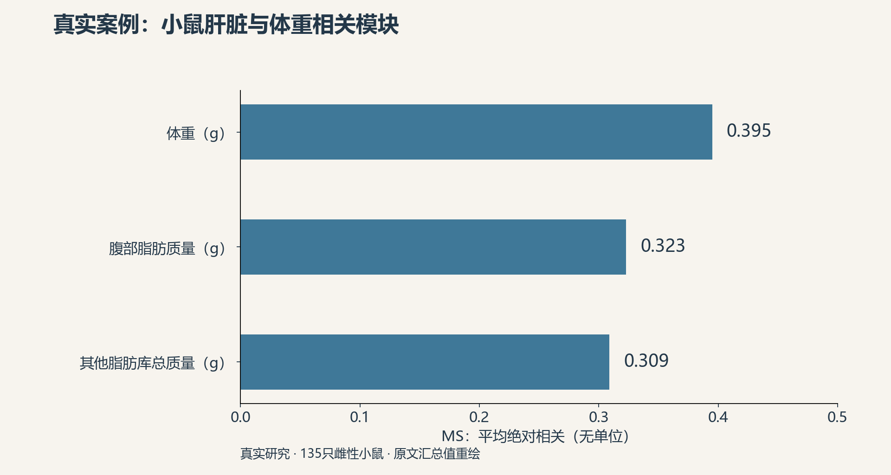
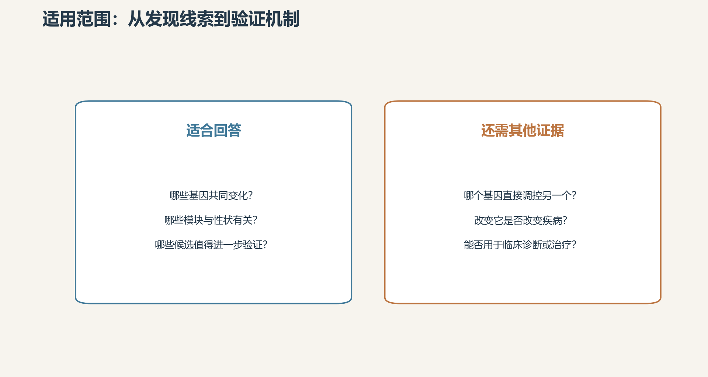

# WGCNA分析：把成千上万个基因整理成可以追问的线索

## 定义解释

一份转录组结果包含成千上万个基因。临床研究常关心：哪些基因共同变化，这些变化与体重、炎症指标或疾病分组有什么联系？WGCNA，即加权基因共表达网络分析，把跨样本变化相似的基因归入“模块”，再研究模块与性状的关系。[方法论文](https://link.springer.com/article/10.1186/1471-2105-9-559)给出了这套框架。

这里的“共表达”是统计上的一起变化。两个基因可以因同一种细胞增多而同时升高，也可以受共同因素影响；一条网络连线本身不能说明谁调控谁。模块颜色只是编号，换一批数据或参数，同名颜色未必代表同一生物过程。

图1｜A、B各代表一组变化相似的基因；曲线为概念示意，横向排列的是不同样本，不代表时间。

## 分析原理

分析先比较每对基因的表达模式，计算相关性，再把相关性转换成连接权重。软阈值通过幂运算连续压低弱连接，保留连接强弱的区别。图2演示有符号网络：强正相关获得较大权重，负相关受到压低；无符号网络则可能把强负相关也视为强连接。

图2｜有符号网络的公式演示：β越大，较弱相关对应的权重越小；β＝6仅为举例。

接着利用拓扑重叠度（TOM）考察两基因是否还连接着相似的邻居，结合聚类树划分模块。每个模块用第一主成分概括主要变化，称为“模块特征向量”（ME）。它给每个样本一个汇总分数，不是某一个真实基因，也不是简单平均值。

图3｜左侧为构造举例的三条标准化表达曲线；右侧为同一矩阵的第一主成分得分，方向已对齐。

将ME与临床指标关联，就能把“几千个基因”缩成“哪些模块值得追查”。模块成员度（MM）表示单个基因与ME的相似程度；模块内连接度表示它与同模块其他基因连接的强弱。二者有联系，但不是同一指标。筛选枢纽基因时还需结合性状关联和后续验证。[模块与性状教程](https://edo98811.github.io/WGCNA_official_documentation/FemaleLiver-03-relateModsToExt.pdf)展示了具体做法。

图4｜先汇总模块，再检验其与性状的关系；混杂因素和多重比较影响证据强度。

## 分析操作

**准备两张表。** 一张是表达矩阵，一张是同批样本的性状表。常用WGCNA函数要求表达矩阵“行是样本、列是基因”。必须按样本编号匹配两表，不能仅凭行数相同就拼接。检查缺失值、重复编号和离群样本；离群的处理应结合测序质量和生物背景。[输入教程](https://edo98811.github.io/WGCNA_official_documentation/FemaleLiver-01-dataInput.pdf)从这些检查开始。

图5｜表达矩阵与性状表使用相同样本编号和顺序；表内文字为字段示意，没有真实患者数据。

**处理表达数据。** RNA-seq数据先过滤低表达基因、做样本间归一化，再采用方差稳定化等变换。先用差异分析筛出显著基因再建网，会把网络限制在预选信号里；可按表达量或变异程度过滤。批次、组织来源及细胞组成也要核查，避免把技术差异或细胞比例变化直接解释为基因调控。

**建网并识别模块。** 用`pickSoftThreshold`考察候选幂值，同时查看拓扑拟合和平均连接度；拟合指标不是研究质量的总分。再用`blockwiseModules`识别模块，记录网络类型、相关方法、最小模块大小、树剪切和模块合并参数。图2的β＝6只是构造举例，不能直接移作项目设置。[建网教程](https://edo98811.github.io/WGCNA_official_documentation/FemaleLiver-02-networkConstr-auto.pdf)提供了完整示范。

图6｜流程从输入检查走向独立验证；软阈值与模块参数需记录，不能只保留最终热图。

**关联、解释并验证。** 连续指标可做相关分析；需要调整年龄、性别等因素时，可将ME放入回归模型。报告效应量、样本数和多重比较校正结果，再结合功能富集、模块成员度和模块内连接筛选候选。保存表达矩阵、模块归属、关联表及参数，便于在独立数据中检验。

**真实案例：小鼠肝脏与体重。** Ghazalpour等在135只雌性小鼠中研究肝脏基因表达与生理性状。原文报告蓝色模块与体重的模块显著性MS为0.395，与腹部脂肪质量的MS为0.323。这里的MS是模块内各基因与性状相关系数绝对值的均值，不能写成“模块ME与体重相关系数为0.395”。[原始研究](https://journals.plos.org/plosgenetics/article?id=10.1371/journal.pgen.0020130)还结合遗传信息追查相关线索。

图7｜据2006年原文摘录重绘：蓝色模块的MS是模块内基因与性状相关系数绝对值的均值，不是模块特征向量相关系数。

后续WGCNA教程从该研究数据整理出3600个表达探针用于演示；起始样本数为135，质控后再开展建网。教程的模块划分与原文不完全相同，复现时应明确采用哪套流程，不能拼接两套结果。[教程数据说明](https://edo98811.github.io/WGCNA_official_documentation/)列出了其来源。

## 适用范围

WGCNA适合在一组可比较、具有足够独立样本的数据中寻找共变化模式，尤其适合把转录组与连续临床指标联系起来。它补充单基因差异分析，提供模块层面的候选线索。

[作者FAQ](https://edo98811.github.io/WGCNA_official_documentation/faq.html)不建议对少于15个样本的数据尝试常规WGCNA，条件允许时至少20个；这是经验建议，不能替代针对研究设计的样本量评估。多个细胞来自同一受试者时，细胞数量也不能直接当作独立受试者数量。疾病分组与批次完全重合时，统计校正难以分辨两种来源。

图8｜左侧列出适合回答的问题；右侧列出需要其他设计或证据支持的结论。

一个高连接基因可以作为后续实验对象；要判断它是否推动疾病变化，仍需时间顺序、干预实验等证据。要形成诊断模型，还需独立队列验证预测性能。把网络发现与验证设计接起来，候选线索才有机会成为可靠结论。

## 参考与致谢

1. Langfelder P, Horvath S. WGCNA: an R package for weighted correlation network analysis. *BMC Bioinformatics*. 2008;9:559. [全文与DOI](https://link.springer.com/article/10.1186/1471-2105-9-559)。
2. Ghazalpour A, et al. Integrating Genetic and Network Analysis to Characterize Genes Related to Mouse Weight. *PLoS Genetics*. 2006;2(8):e130. [全文与DOI](https://journals.plos.org/plosgenetics/article?id=10.1371/journal.pgen.0020130)。
3. Langfelder P, Horvath S. WGCNA教程I：[数据清理](https://edo98811.github.io/WGCNA_official_documentation/FemaleLiver-01-dataInput.pdf)、[建网与模块](https://edo98811.github.io/WGCNA_official_documentation/FemaleLiver-02-networkConstr-auto.pdf)、[性状关联](https://edo98811.github.io/WGCNA_official_documentation/FemaleLiver-03-relateModsToExt.pdf)。2014年版；链接为作者文档的公开镜像。
4. [WGCNA FAQ](https://edo98811.github.io/WGCNA_official_documentation/faq.html)，更新于2020年；访问日期：2026年11月10日。

感谢方法作者及原始研究团队公开论文、教程和数据。图1为共表达概念插画，图2—6、8为本篇制作的解释图，图7按原文汇总值重绘；均未直接复制论文图片。
